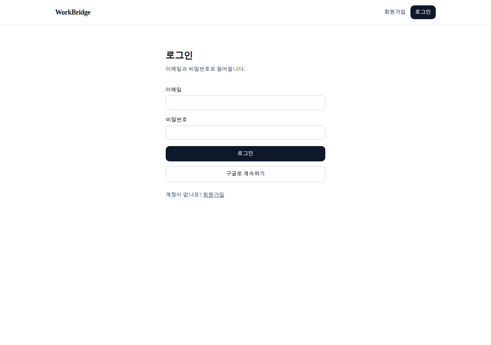
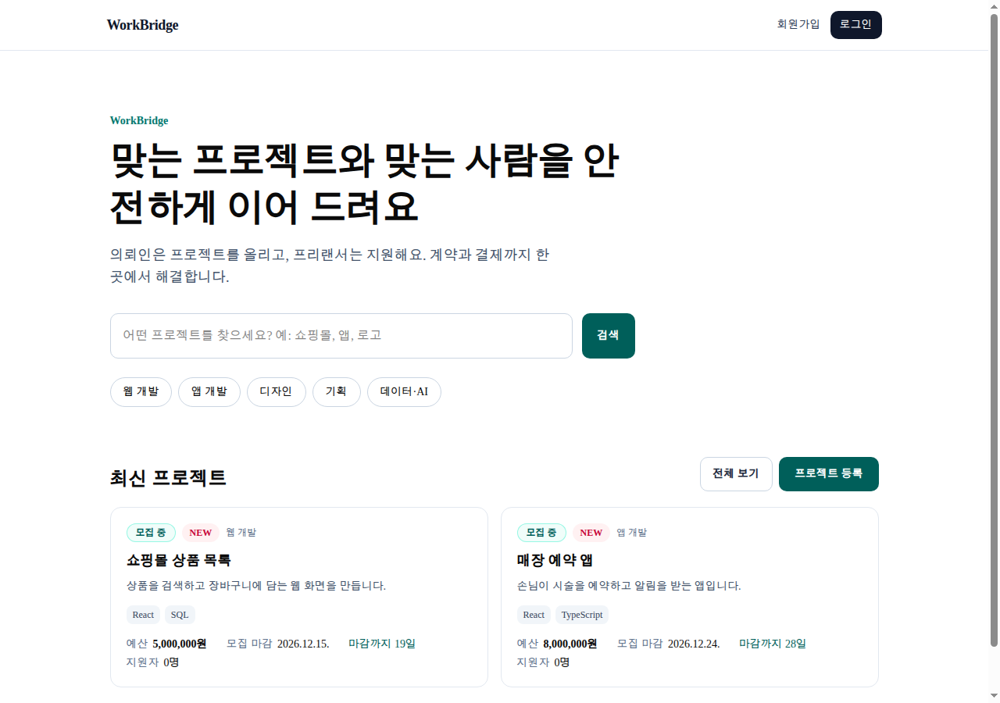
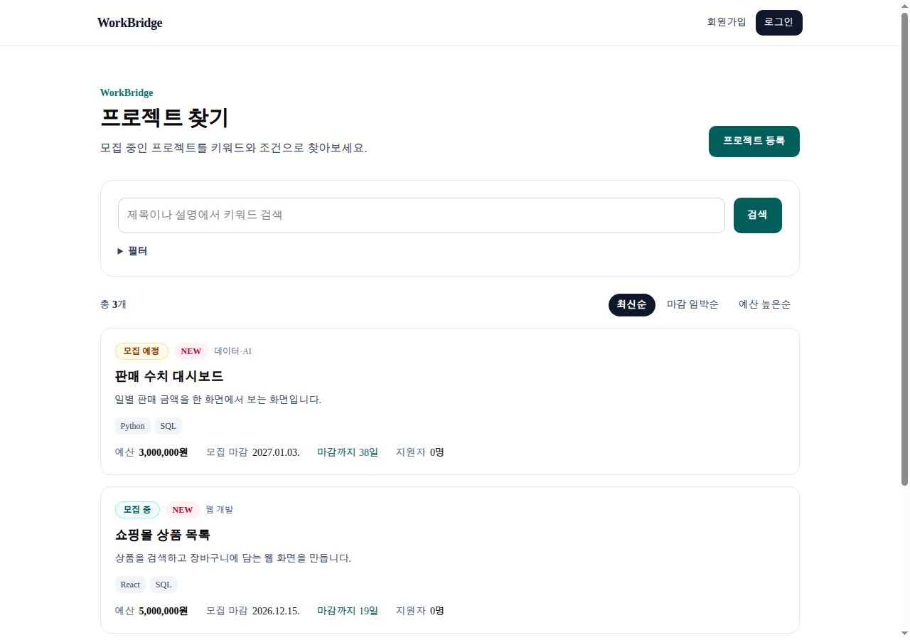

# 우리가 지금 어디까지 왔나

작성: 2026년 11월 25일 (한국시간)

이 글은 코드를 몰라도 읽을 수 있게 쓴 학습 자료입니다. 다섯 명이 나눠 만든 일이 한 사이트에서 어떻게 이어지는지, 그리고 오늘 배포된 화면 기준으로 어디가 끝났는지를 적습니다.

사이트 주소: https://workbridge-tom-f7d5.vercel.app

한 줄로 보면, **사람을 만들고(1번) → 프로젝트를 올리고(2번) → 지원하고 알림을 받고(3번) → 계약하고(4번) → 돈을 맡겼다가 리뷰를 남기는(5번)** 순서입니다. 1·2·3번 화면은 배포 사이트에서 볼 수 있습니다. 4번은 아직 화면이 없습니다. 5번 화면은 주소는 있지만, 4번 계약이 있어야 결제가 이어집니다.

## 전체 지도

| 순서 | 담당 | 브랜치 | 오늘 기준 |
| --- | --- | --- | --- |
| 1 | 1번. 기반·로그인·프로필·배포·합치기 | `feat/1-auth-profile` | 화면과 배포가 되어 있음. 명세도 `main`에 있음 |
| 2 | 2번. 프로젝트 등록·찾기·북마크·홈 | `feat/2-projects` | 홈과 목록이 배포 사이트에 보임. 명세도 `main`에 있음 |
| 3 | 3번. 지원·선정·알림 | `feat/3-applications-notifications` | 화면 코드와 명세가 `main`에 있음. 종 모양은 헤더에 아직 안 끼움 |
| 4 | 4번. AI 단가·금액 합의·계약·서명 | `feat/4-ai-contract` | `main`에 없는 새 작업이 없음. 계약 표도 아직 없음 |
| 5 | 5번. 결제·정산·리뷰 | `feat/5-payment-review` | 화면 코드는 `main`에 있음. 테스트 키는 배포에 연결됨. 계약이 없어 결제 끝까지는 아직 |

아래 화면은 2026년 11월 25일 오후(한국시간)에 배포 주소를 열어서 찍은 것입니다.

## 1번. 로그인과 프로필, 그리고 사이트를 계속 합치는 일

브랜치 `feat/1-auth-profile`.

한 일:

- 공용 데이터베이스와 배포 사이트를 만들었습니다.
- 회원가입, 로그인, 구글 로그인, 역할 선택(의뢰인/프리랜서), 내 프로필, 공개 프로필을 만들었습니다.
- 위쪽 메뉴(헤더)를 만들었습니다. 로그인 전에는 회원가입과 로그인, 로그인 후에는 역할에 따라 내 프로젝트나 내 지원이 보입니다.
- 다른 번호가 올린 브랜치를 충돌 없이 `main`에 합치고, 합친 뒤에 사이트가 다시 배포되게 했습니다.
- 기능 명세서 `docs/specs/1-auth-profile.md`, 세부 명세서 `docs/specs/1-auth-profile-detail.md`.

결과:

- 배포 사이트 오른쪽 위에 회원가입과 로그인이 보입니다.
- 로그인 화면에서 이메일 로그인과 구글 로그인을 고를 수 있습니다.



아직 남은 것:

- 3번이 만든 알림 종을 헤더 자리에 끼우기
- 5번이 만든 평균 별점과 리뷰 목록을 공개 프로필 자리에 끼우기

## 2번. 프로젝트를 올리고 찾는 일

브랜치 `feat/2-projects`.

한 일:

- 홈 화면, 프로젝트 목록, 상세, 등록, 수정, 내 프로젝트, 북마크를 만들었습니다.
- 검색, 분야 버튼, 예산·마감일 정렬이 있습니다.
- 데이터베이스 파일 `0200`부터 `0203`까지 있습니다.
- 기능 목록 `docs/specs/2-projects-feature-list.md`, 세부 명세 `docs/specs/2-projects-detail-spec.md`.

결과:

- 배포된 홈에 시연용 프로젝트가 카드로 보입니다. 쇼핑몰 상품 목록, 매장 예약 앱입니다.
- 프로젝트 찾기 화면에는 같은 글이 검색·정렬과 함께 세 건 보입니다. 판매 수치 대시보드는 모집 예정입니다.





이 화면이 보인다는 것은 2번 일이 배포까지 연결됐다는 뜻입니다. 카드를 누르면 상세로 가고, 로그인하지 않으면 지원이나 등록은 로그인으로 보냅니다.

## 3번. 지원하고 알림을 받는 일

브랜치 `feat/3-applications-notifications`.

한 일:

- 프로젝트에 지원하는 화면, 의뢰인이 지원자를 보고 한 명을 고르는 화면, 내 지원 현황을 만들었습니다.
- 알림 목록과 종 모양 컴포넌트를 만들었습니다. 새 알림이 오면 목록이 바뀌도록 준비했습니다.
- 데이터베이스 파일 `0300`부터 `0303`까지 있습니다.
- 기능 명세서 `docs/specs/3-applications-notifications.md`, 세부 명세서 `docs/specs/3-applications-notifications-detail.md`.

결과:

- 코드는 `main`에 들어 있고 빌드도 통과했습니다.
- 지원과 알림은 로그인한 뒤에만 의미가 있어서, 위 공개 화면 스크린샷에는 나오지 않습니다. 주소는 `/projects/[번호]/apply`, `/me/applications`, `/notifications` 입니다.

아직 남은 것:

- 종 모양을 1번 헤더에 끼워야 누구나 종을 봅니다. 컴포넌트는 3번이 만들어 두었습니다.
- 공용 데이터베이스에 3번 SQL이 모두 실행됐는지는 팀에서 한 번 더 확인이 필요합니다. 이미 성공한 파일은 다시 실행하지 않습니다.

## 4번. 금액 합의와 계약

브랜치 `feat/4-ai-contract`.

한 일:

- 오늘 `main`을 기준으로 보면, 이 브랜치에는 아직 합칠 새 커밋이 없습니다.
- 계약 표(`contracts`)도 저장소에 없습니다.

결과:

- 배포 사이트에 계약 목록이나 서명 화면이 없습니다.
- 그래서 5번 결제는 "서명이 끝난 계약"을 기다립니다. 그 공백을 메우려고 5번이 시연용 계약 파일만 따로 두었습니다. `supabase/seeds/0502_demo_contract.sql`. 4번 계약 표가 생기면 이 파일은 실행하지 않습니다.

4번이 만들 주소는 `/ai-estimate/[프로젝트번호]`, `/contracts`, `/contracts/[번호]` 입니다.

## 5번. 결제, 정산, 리뷰

브랜치 `feat/5-payment-review`. 오늘 5번 담당이 결석해서 1번이 같은 브랜치에 화면을 올렸습니다.

한 일:

- 결제 화면, 성공/실패 화면, 내 결제 내역을 만들었습니다.
- 승인할 때 브라우저가 보낸 금액은 믿지 않고, 데이터베이스에 적힌 계약 금액만 토스에 보냅니다.
- 납품 요청과 완료 승인 버튼을 컴포넌트로 만들어 4번 계약 화면에 끼울 수 있게 두었습니다. 실제 송금은 하지 않고, 수수료 10%를 뺀 금액만 확정합니다.
- 리뷰 작성 화면과, 공개 프로필에 넣을 평균 별점·리뷰 목록 컴포넌트를 만들었습니다.
- 토스 테스트 키 두 개(`NEXT_TOSS_CLIENT_KEY`, `TOSS_SECRET_KEY`)는 Vercel 프로덕션에 등록되어 있습니다. 값은 이 문서에 적지 않습니다.
- 기능 명세 `docs/specs/5-payment-review.md`.

결과:

- 화면 주소는 배포에 포함되어 있습니다. `/payments/[계약번호]`, `/payments/history`, `/reviews/new/[계약번호]`.
- 계약 데이터가 없으면 결제 화면은 "이 계약을 볼 수 없습니다"로 끝납니다. 테스트 카드로 결제부터 리뷰까지 한 번에 누른 기록은 아직 없습니다.

## 그래서 우리는 어디쯤인가

```text
가입/로그인 ── 프로젝트 올리기 ── 지원/알림 ── 계약/서명 ── 결제/리뷰
   1번 됨         2번 됨          3번 코드 됨      4번 아직        5번 화면만 됨
```

지금 배포 사이트를 열면 **홈에서 프로젝트를 찾고, 로그인 화면까지**는 바로 볼 수 있습니다. 그 다음인 지원은 로그인 뒤에 코드가 있습니다. 계약서부터는 4번 결과가 와야 5번 결제가 끝까지 갑니다.

팀원이 자기 명세를 더 읽고 싶으면 `docs/specs/` 에서 번호로 시작하면 됩니다.
