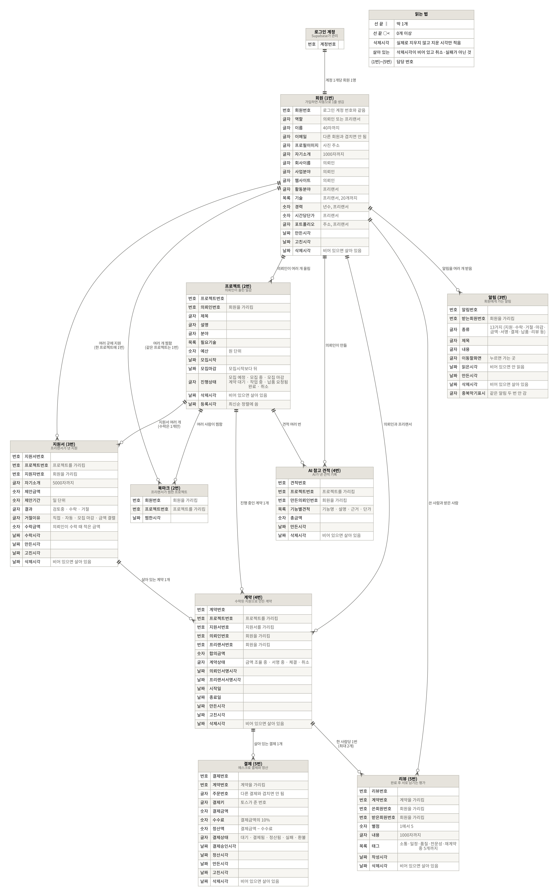

# 2번이 그린 전체 ERD

- 담당: 2번 / 브랜치 `feat/2-projects` / 작성: 2026-11-26
- 근거: `main` 의 `supabase/migrations/` SQL 18개(`0100`~`0502`), `docs/specs/` 1~5번 명세서, `docs/TEAM.md` 2장
- 목적: 각자 그려 온 전체 ERD를 비교하고 토론하기 위한 2번의 그림입니다.
- 그림 파일: `docs/specs/2-erd.png`

## 0. 확인한 방법

- SQL 18개를 열어 `create table` 에 적힌 컬럼을 하나도 빼지 않고 옮겼습니다. 그림의 한글 이름 옆 DB 이름은 아래 표에 있습니다.
- 명세서 1~5번에 나오는 영어 이름을 SQL 컬럼과 하나씩 대조했습니다. 명세서에만 있고 SQL 에 없는 컬럼은 없었습니다. (명세서에만 나오는 이름은 함수 이름과 상태값이었습니다.)
- 선 옆에 적은 "한 번만" 규칙은 SQL 의 `unique`, `primary key`, 조건이 붙은 고유 인덱스에서 가져왔습니다.
- 5장 "한 프로젝트가 지나가는 길"은 SQL 함수 안의 상태 변경 순서를 읽고 적었습니다. 실제 DB 에서 실행해 보지는 않았습니다.

## 1. 그림 읽는 법

| 표시 | 뜻 |
| --- | --- |
| 표 하나 | 저장하는 정보 한 종류 (DB 테이블) |
| 줄 하나 | 그 표에 적는 항목 하나 (컬럼). 왼쪽 칸은 값의 형태(번호·글자·숫자·날짜·목록) |
| "○○을 가리킴" | 다른 표의 한 줄을 가리키는 번호 (외래키) |
| 선 끝 ‖ | 딱 1개 |
| 선 끝 ○< | 0개 이상 |
| (1번)~(5번) | 그 표를 만든 담당 번호 (`docs/TEAM.md` 2장) |
| 삭제시각 | 실제로 지우지 않고 지운 시각만 적습니다. 비어 있으면 살아 있는 줄입니다 (TEAM.md "소프트 삭제만") |
| 살아 있는 | 삭제시각이 비어 있고, 취소·실패가 아닌 것 |

## 2. 표 10개와 항목

### 로그인 계정 — `auth.users` (Supabase 관리)
팀이 만든 표가 아니라 Supabase Auth 가 관리합니다. 회원 표가 이 번호를 그대로 씁니다.

### 회원 (1번) — `profiles`
가입하면 자동으로 한 줄이 생깁니다. 의뢰인 항목과 프리랜서 항목이 한 표에 같이 있고, 역할에 맞는 칸만 채웁니다.

| 그림 이름 | DB 이름 | 형태 | 규칙 |
| --- | --- | --- | --- |
| 회원번호 | `id` | 번호 | `auth.users.id` 와 같음 |
| 역할 | `role` | 글자 | `client` · `freelancer` (비어 있을 수 있음) |
| 이름 | `name` | 글자 | 40자까지 |
| 이메일 | `email` | 글자 | 다른 회원과 겹치면 안 됨 |
| 프로필이미지 | `avatar_url` | 글자 | 사진 주소 |
| 자기소개 | `bio` | 글자 | 1000자까지 |
| 회사이름 | `company_name` | 글자 | 의뢰인 |
| 사업분야 | `business_field` | 글자 | 의뢰인 |
| 웹사이트 | `website` | 글자 | 의뢰인, 300자까지 |
| 활동분야 | `category` | 글자 | 프리랜서 |
| 기술 | `skills` | 목록 | 프리랜서, 20개까지 |
| 경력 | `career_years` | 숫자 | 프리랜서, 년수, 0 이상 |
| 시간당단가 | `hourly_rate` | 숫자 | 프리랜서, 0 이상 |
| 포트폴리오 | `portfolio_url` | 글자 | 프리랜서, 300자까지 |
| 만든시각 · 고친시각 · 삭제시각 | `created_at` · `updated_at` · `deleted_at` | 날짜 | |

### 프로젝트 (2번) — `projects`

| 그림 이름 | DB 이름 | 형태 | 규칙 |
| --- | --- | --- | --- |
| 프로젝트번호 | `id` | 번호 | |
| 의뢰인번호 | `client_id` | 번호 | 회원을 가리킴 |
| 제목 · 설명 · 분야 | `title` · `description` · `category` | 글자 | |
| 필요기술 | `skills` | 목록 | |
| 예산 | `budget` | 숫자 | 원 단위, 0 이상 |
| 모집시작 · 모집마감 | `recruit_start_at` · `recruit_end_at` | 날짜 | 마감이 시작보다 뒤 |
| 진행상태 | `status` | 글자 | 아래 3장 |
| 삭제시각 | `deleted_at` | 날짜 | |
| 등록시각 | `created_at` | 날짜 | 최신순 정렬에 씀 |

### 북마크 (2번) — `bookmarks`

| 그림 이름 | DB 이름 | 형태 | 규칙 |
| --- | --- | --- | --- |
| 회원번호 | `user_id` | 번호 | 회원을 가리킴 |
| 프로젝트번호 | `project_id` | 번호 | 프로젝트를 가리킴. 회원번호와 짝으로 한 번만 |
| 찜한시각 | `created_at` | 날짜 | |

### 지원서 (3번) — `applications`

| 그림 이름 | DB 이름 | 형태 | 규칙 |
| --- | --- | --- | --- |
| 지원서번호 | `id` | 번호 | |
| 프로젝트번호 | `project_id` | 번호 | 프로젝트를 가리킴 |
| 지원자번호 | `freelancer_id` | 번호 | 회원을 가리킴. 한 프로젝트에 한 번만 |
| 자기소개 | `cover_letter` | 글자 | 5000자까지 |
| 제안금액 | `proposed_amount` | 숫자 | |
| 제안기간 | `proposed_days` | 숫자 | 일 단위 |
| 결과 | `status` | 글자 | 아래 3장 |
| 거절이유 | `reject_reason` | 글자 | 거절일 때만 채움 |
| 수락금액 | `accepted_agreed_amount` | 숫자 | 의뢰인이 수락 때 적은 금액 |
| 수락시각 | `accepted_at` | 날짜 | |
| 만든시각 · 고친시각 · 삭제시각 | `created_at` · `updated_at` · `deleted_at` | 날짜 | |

### 알림 (3번) — `notifications`

| 그림 이름 | DB 이름 | 형태 | 규칙 |
| --- | --- | --- | --- |
| 알림번호 | `id` | 번호 | |
| 받는회원번호 | `user_id` | 번호 | 회원을 가리킴 |
| 종류 | `type` | 글자 | 13가지 (TEAM.md 3장) |
| 제목 · 내용 | `title` · `body` | 글자 | 200자 · 2000자까지 |
| 이동할화면 | `link` | 글자 | 누르면 가는 곳 |
| 읽은시각 | `read_at` | 날짜 | 비어 있으면 안 읽음 |
| 만든시각 · 삭제시각 | `created_at` · `deleted_at` | 날짜 | |
| 중복막기표시 | `event_key` | 글자 | 같은 회원에게 같은 알림이 두 번 안 감 |

### AI 참고 견적 (4번) — `ai_estimates`

| 그림 이름 | DB 이름 | 형태 | 규칙 |
| --- | --- | --- | --- |
| 견적번호 | `id` | 번호 | |
| 프로젝트번호 | `project_id` | 번호 | 프로젝트를 가리킴 |
| 만든의뢰인번호 | `client_id` | 번호 | 회원을 가리킴 |
| 기능별견적 | `items` | 목록 | 기능마다 이름·설명·근거·단가, 100개까지 |
| 총금액 | `total_amount` | 숫자 | |
| 만든시각 · 삭제시각 | `created_at` · `deleted_at` | 날짜 | |

### 계약 (4번) — `contracts`

| 그림 이름 | DB 이름 | 형태 | 규칙 |
| --- | --- | --- | --- |
| 계약번호 | `id` | 번호 | |
| 프로젝트번호 | `project_id` | 번호 | 프로젝트를 가리킴 |
| 지원서번호 | `application_id` | 번호 | 지원서를 가리킴 |
| 의뢰인번호 · 프리랜서번호 | `client_id` · `freelancer_id` | 번호 | 회원을 가리킴. 둘이 같으면 안 됨 |
| 합의금액 | `agreed_amount` | 숫자 | |
| 계약상태 | `status` | 글자 | 아래 3장 |
| 의뢰인서명시각 · 프리랜서서명시각 | `client_signed_at` · `freelancer_signed_at` | 날짜 | |
| 시작일 · 종료일 | `start_date` · `end_date` | 날짜 | |
| 만든시각 · 고친시각 · 삭제시각 | `created_at` · `updated_at` · `deleted_at` | 날짜 | |

### 결제 (5번) — `payments`

| 그림 이름 | DB 이름 | 형태 | 규칙 |
| --- | --- | --- | --- |
| 결제번호 | `id` | 번호 | |
| 계약번호 | `contract_id` | 번호 | 계약을 가리킴 |
| 주문번호 | `order_id` | 글자 | 다른 결제와 겹치면 안 됨, `wb_` 로 시작 |
| 결제키 | `payment_key` | 글자 | 토스가 준 번호 |
| 결제금액 | `amount` | 숫자 | 0보다 큼 |
| 수수료 | `fee_amount` | 숫자 | 결제금액의 10% (DB 가 검사) |
| 정산액 | `payout_amount` | 숫자 | 결제금액 − 수수료 (DB 가 검사) |
| 결제상태 | `status` | 글자 | 아래 3장 |
| 결제승인시각 · 정산시각 | `approved_at` · `paid_out_at` | 날짜 | |
| 만든시각 · 고친시각 · 삭제시각 | `created_at` · `updated_at` · `deleted_at` | 날짜 | |

### 리뷰 (5번) — `reviews`

| 그림 이름 | DB 이름 | 형태 | 규칙 |
| --- | --- | --- | --- |
| 리뷰번호 | `id` | 번호 | |
| 계약번호 | `contract_id` | 번호 | 계약을 가리킴 |
| 쓴회원번호 · 받은회원번호 | `reviewer_id` · `reviewee_id` | 번호 | 회원을 가리킴. 둘이 같으면 안 됨 |
| 별점 | `rating` | 숫자 | 1에서 5 |
| 내용 | `content` | 글자 | 1000자까지 |
| 태그 | `tags` | 목록 | 소통·일정·품질·전문성·재계약 중 5개까지 |
| 작성시각 · 삭제시각 | `created_at` · `deleted_at` | 날짜 | |

## 3. 상태값

| 표 | DB 값 → 화면 이름 |
| --- | --- |
| 프로젝트 `status` | `scheduled` 모집 예정 · `recruiting` 모집 중 · `closed` 모집 마감 · `contract_pending` 계약 대기 · `in_progress` 작업 중 · `delivered` 납품 요청 · `completed` 완료 · `cancelled` 취소 |
| 지원서 `status` | `pending` 검토중 · `accepted` 수락 · `rejected` 거절 |
| 지원서 `reject_reason` | `manual` 직접 거절 · `auto` 다른 지원자 수락 · `closed` 모집 마감 · `negotiation_failed` 금액 합의 결렬 |
| 계약 `status` | `negotiating` 금액 합의 중 · `signing` 서명 중 · `signed` 체결 · `cancelled` 취소 |
| 결제 `status` | `ready` 대기 · `paid` 결제됨(에스크로 보관) · `paid_out` 정산 완료 · `failed` 실패 · `refunded` 환불 |

## 4. 표 사이의 연결

| 선 | 그림의 글 | SQL 근거 |
| --- | --- | --- |
| 로그인 계정 → 회원 | 계정 1개당 회원 1명 | `profiles.id` → `auth.users` |
| 회원 → 프로젝트 | 의뢰인이 여러 개 올림 | `projects.client_id` |
| 회원 → 알림 | 알림을 여러 개 받음 | `notifications.user_id` |
| 회원 → 북마크 | 여러 개 찜함 (같은 프로젝트는 1번) | `bookmarks.user_id`, `primary key (user_id, project_id)` |
| 회원 → 지원서 | 여러 곳에 지원 (한 프로젝트에 1번) | `applications.freelancer_id`, `unique (project_id, freelancer_id)` |
| 회원 → AI 참고 견적 | 의뢰인이 만듦 | `ai_estimates.client_id` |
| 회원 → 계약 | 의뢰인과 프리랜서 | `contracts.client_id`, `contracts.freelancer_id` |
| 회원 → 리뷰 | 쓴 사람과 받은 사람 | `reviews.reviewer_id`, `reviews.reviewee_id` |
| 프로젝트 → 북마크 | 여러 사람이 찜함 | `bookmarks.project_id` |
| 프로젝트 → 지원서 | 지원서 여러 개 (수락은 1개만) | `applications.project_id`, `applications_one_accepted_per_project` |
| 프로젝트 → AI 참고 견적 | 견적 여러 번 | `ai_estimates.project_id` |
| 프로젝트 → 계약 | 진행 중인 계약 1개 | `contracts.project_id`, `contracts_one_open_per_project` (취소가 아닌 것) |
| 지원서 → 계약 | 살아 있는 계약 1개 | `contracts.application_id`, `contracts_one_per_application` |
| 계약 → 결제 | 살아 있는 결제 1개 | `payments.contract_id`, `payments_one_active_per_contract` (대기·결제됨·정산 완료) |
| 계약 → 리뷰 | 한 사람당 1번 (최대 2개) | `reviews.contract_id`, `unique (contract_id, reviewer_id)` |

## 5. 한 프로젝트가 지나가는 길

SQL 함수에 적힌 순서입니다. 알림은 모두 `create_notification` 으로 만들어집니다.

| 단계 | 바뀌는 것 | 알림 | 담당 |
| --- | --- | --- | --- |
| 1. 지원 | 지원서 생김(검토중) | 의뢰인에게 `application_submitted` | 3 |
| 2. 수락 | 그 지원서 수락, 나머지 대기 지원서 `auto` 거절, 프로젝트 계약 대기, 계약이 금액 합의 중으로 생김 | 수락된 사람·의뢰인에게 `application_accepted`, 거절된 사람에게 `application_auto_rejected`, 계약이 생길 때 `amount_proposed` | 3, 4 |
| 2-1. 금액 거부 | 그 지원서 `negotiation_failed` 거절, 프로젝트 모집 중으로 복귀 | `amount_declined` | 4 |
| 3. 금액 동의·서명 | 계약 서명 중 → 체결 | 동의 때 `amount_agreed`, 체결 때 `contract_signed` | 4 |
| 4. 결제 | 결제 결제됨, 프로젝트 작업 중 | `payment_completed` | 5 |
| 5. 납품 요청 | 프로젝트 납품 요청 | `delivery_requested` | 5 |
| 6. 완료 승인 | 프로젝트 완료, 결제 정산 완료 | `delivery_approved`, `review_requested` | 5 |
| 7. 리뷰 | 리뷰 생김 (서로 한 번씩) | | 5 |
| 모집 마감 | 대기 지원서 전부 `closed` 거절, 프로젝트 모집 마감 | 지원자 전원에게 `project_closed` | 2 → 3번 함수 |
| 직접 거절 | 그 지원서 `manual` 거절 | `application_rejected` | 3 |
