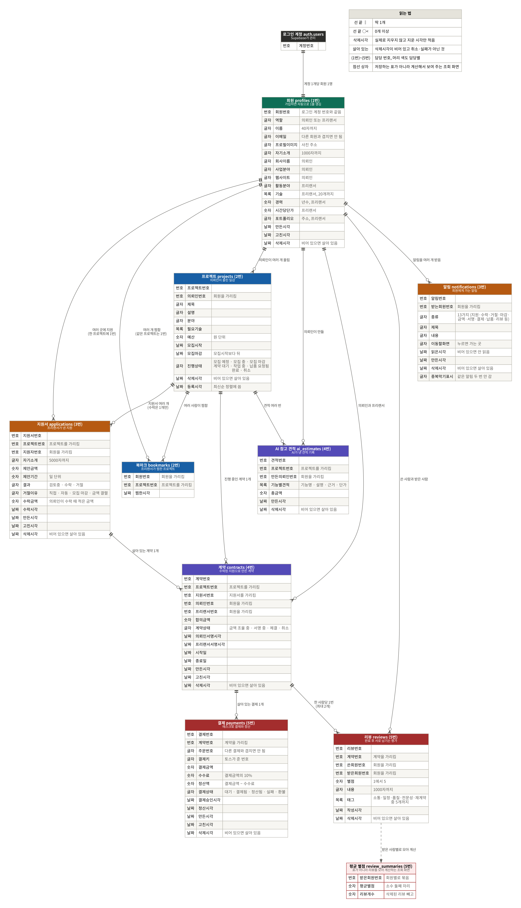

# WorkBridge 통합 ERD (1번 + 2번)

- 작성: 2026-11-27 / 2번 브랜치 `feat/2-projects`
- 합친 문서: 1번 `docs/specs/erd.md`·`erd.png`(위시켓 공개 화면 기준 요약판), 2번 `docs/specs/2-erd.md`·`2-erd.png`(SQL 항목 전체판)
- 두 원본은 그대로 두고, 합친 결과만 새 이름으로 저장했습니다.
- 근거: `main` 의 `supabase/migrations/` SQL `0100`~`0502`, `docs/specs/` 1~5번 명세서·세부 명세서, `docs/TEAM.md` 2장
- 그림 파일: `docs/specs/erd-통합.png`

## 0. 어떻게 합쳤나

- 표와 항목, 선, "한 번만" 규칙은 2번 그림을 바탕으로 했습니다. SQL 항목을 하나도 빼지 않은 판이라서입니다.
- 1번 그림에서 세 가지를 가져왔습니다. 표 이름 옆 DB 이름(예: 회원 `profiles`), 담당별 머리 색, 평균 별점 조회 화면 `review_summaries` 입니다.
- 1번 문서의 위시켓 공개 화면 비교(6~8장)는 그대로 옮겼습니다.
- 두 원본 사이에 서로 어긋나는 내용은 없었습니다. 1번 그림에서 계약·결제 상태를 일부만 적은 것은 그림을 줄이며 뺀 것이라, 통합판에는 전부 적었습니다.
- 4번·5번 세부 명세서(2026-11-26 추가)의 데이터 명세 장과도 대조했습니다. 항목은 같고, 함수가 더 좁게 막는 규칙(견적 기능 1~12개, 단가 1만~5억 원 등)은 표 구조가 아니라서 그림에 넣지 않았습니다.
- 5장 "한 프로젝트가 지나가는 길"은 SQL 함수 안의 상태 변경 순서를 읽고 적었습니다. 실제 DB 에서 실행해 보지는 않았습니다.

## 1. 그림 읽는 법

| 표시 | 뜻 |
| --- | --- |
| 표 하나 | 저장하는 정보 한 종류 (DB 테이블) |
| 줄 하나 | 그 표에 적는 항목 하나 (컬럼). 왼쪽 칸은 값의 형태(번호·글자·숫자·날짜·목록) |
| "○○을 가리킴" | 다른 표의 한 줄을 가리키는 번호 (외래키) |
| 선 끝 ‖ | 딱 1개 |
| 선 끝 ○< | 0개 이상 |
| (1번)~(5번) | 그 표를 만든 담당 번호 (`docs/TEAM.md` 2장). 표 머리 색도 담당별 (1번 초록, 2번 파랑, 3번 주황, 4번 보라, 5번 빨강) |
| 점선 상자 | 저장하는 표가 아니라 계산해서 보여 주는 조회 화면 |
| 삭제시각 | 실제로 지우지 않고 지운 시각만 적습니다. 비어 있으면 살아 있는 줄입니다 (TEAM.md "소프트 삭제만") |
| 살아 있는 | 삭제시각이 비어 있고, 취소·실패가 아닌 것 |

## 2. 표 10개와 항목

### 로그인 계정 — `auth.users` (Supabase 관리)
팀이 만든 표가 아니라 Supabase Auth 가 관리합니다. 회원 표가 이 번호를 그대로 씁니다.

### 회원 (1번) — `profiles`
가입하면 자동으로 한 줄이 생깁니다. 의뢰인 항목과 프리랜서 항목이 한 표에 같이 있고, 역할에 맞는 칸만 채웁니다.

| 그림 이름 | DB 이름 | 형태 | 규칙 |
| --- | --- | --- | --- |
| 회원번호 | `id` | 번호 | `auth.users.id` 와 같음 |
| 역할 | `role` | 글자 | `client` · `freelancer` (비어 있을 수 있음) |
| 이름 | `name` | 글자 | 40자까지 |
| 이메일 | `email` | 글자 | 다른 회원과 겹치면 안 됨 |
| 프로필이미지 | `avatar_url` | 글자 | 사진 주소 |
| 자기소개 | `bio` | 글자 | 1000자까지 |
| 회사이름 | `company_name` | 글자 | 의뢰인 |
| 사업분야 | `business_field` | 글자 | 의뢰인 |
| 웹사이트 | `website` | 글자 | 의뢰인, 300자까지 |
| 활동분야 | `category` | 글자 | 프리랜서 |
| 기술 | `skills` | 목록 | 프리랜서, 20개까지 |
| 경력 | `career_years` | 숫자 | 프리랜서, 년수, 0 이상 |
| 시간당단가 | `hourly_rate` | 숫자 | 프리랜서, 0 이상 |
| 포트폴리오 | `portfolio_url` | 글자 | 프리랜서, 300자까지 |
| 만든시각 · 고친시각 · 삭제시각 | `created_at` · `updated_at` · `deleted_at` | 날짜 | |

### 프로젝트 (2번) — `projects`

| 그림 이름 | DB 이름 | 형태 | 규칙 |
| --- | --- | --- | --- |
| 프로젝트번호 | `id` | 번호 | |
| 의뢰인번호 | `client_id` | 번호 | 회원을 가리킴 |
| 제목 · 설명 · 분야 | `title` · `description` · `category` | 글자 | |
| 필요기술 | `skills` | 목록 | |
| 예산 | `budget` | 숫자 | 원 단위, 0 이상 |
| 모집시작 · 모집마감 | `recruit_start_at` · `recruit_end_at` | 날짜 | 마감이 시작보다 뒤 |
| 진행상태 | `status` | 글자 | 아래 3장 |
| 삭제시각 | `deleted_at` | 날짜 | |
| 등록시각 | `created_at` | 날짜 | 최신순 정렬에 씀 |

### 북마크 (2번) — `bookmarks`

| 그림 이름 | DB 이름 | 형태 | 규칙 |
| --- | --- | --- | --- |
| 회원번호 | `user_id` | 번호 | 회원을 가리킴 |
| 프로젝트번호 | `project_id` | 번호 | 프로젝트를 가리킴. 회원번호와 짝으로 한 번만 |
| 찜한시각 | `created_at` | 날짜 | |

### 지원서 (3번) — `applications`

| 그림 이름 | DB 이름 | 형태 | 규칙 |
| --- | --- | --- | --- |
| 지원서번호 | `id` | 번호 | |
| 프로젝트번호 | `project_id` | 번호 | 프로젝트를 가리킴 |
| 지원자번호 | `freelancer_id` | 번호 | 회원을 가리킴. 한 프로젝트에 한 번만 |
| 자기소개 | `cover_letter` | 글자 | 5000자까지 |
| 제안금액 | `proposed_amount` | 숫자 | |
| 제안기간 | `proposed_days` | 숫자 | 일 단위 |
| 결과 | `status` | 글자 | 아래 3장 |
| 거절이유 | `reject_reason` | 글자 | 거절일 때만 채움 |
| 수락금액 | `accepted_agreed_amount` | 숫자 | 의뢰인이 수락 때 적은 금액 |
| 수락시각 | `accepted_at` | 날짜 | |
| 만든시각 · 고친시각 · 삭제시각 | `created_at` · `updated_at` · `deleted_at` | 날짜 | |

### 알림 (3번) — `notifications`

| 그림 이름 | DB 이름 | 형태 | 규칙 |
| --- | --- | --- | --- |
| 알림번호 | `id` | 번호 | |
| 받는회원번호 | `user_id` | 번호 | 회원을 가리킴 |
| 종류 | `type` | 글자 | 13가지 (TEAM.md 3장) |
| 제목 · 내용 | `title` · `body` | 글자 | 200자 · 2000자까지 |
| 이동할화면 | `link` | 글자 | 누르면 가는 곳 |
| 읽은시각 | `read_at` | 날짜 | 비어 있으면 안 읽음 |
| 만든시각 · 삭제시각 | `created_at` · `deleted_at` | 날짜 | |
| 중복막기표시 | `event_key` | 글자 | 같은 회원에게 같은 알림이 두 번 안 감 |

### AI 참고 견적 (4번) — `ai_estimates`

| 그림 이름 | DB 이름 | 형태 | 규칙 |
| --- | --- | --- | --- |
| 견적번호 | `id` | 번호 | |
| 프로젝트번호 | `project_id` | 번호 | 프로젝트를 가리킴 |
| 만든의뢰인번호 | `client_id` | 번호 | 회원을 가리킴 |
| 기능별견적 | `items` | 목록 | 기능마다 이름·설명·근거·단가, 100개까지 |
| 총금액 | `total_amount` | 숫자 | |
| 만든시각 · 삭제시각 | `created_at` · `deleted_at` | 날짜 | |

### 계약 (4번) — `contracts`

| 그림 이름 | DB 이름 | 형태 | 규칙 |
| --- | --- | --- | --- |
| 계약번호 | `id` | 번호 | |
| 프로젝트번호 | `project_id` | 번호 | 프로젝트를 가리킴 |
| 지원서번호 | `application_id` | 번호 | 지원서를 가리킴 |
| 의뢰인번호 · 프리랜서번호 | `client_id` · `freelancer_id` | 번호 | 회원을 가리킴. 둘이 같으면 안 됨 |
| 합의금액 | `agreed_amount` | 숫자 | |
| 계약상태 | `status` | 글자 | 아래 3장 |
| 의뢰인서명시각 · 프리랜서서명시각 | `client_signed_at` · `freelancer_signed_at` | 날짜 | |
| 시작일 · 종료일 | `start_date` · `end_date` | 날짜 | |
| 만든시각 · 고친시각 · 삭제시각 | `created_at` · `updated_at` · `deleted_at` | 날짜 | |

### 결제 (5번) — `payments`

| 그림 이름 | DB 이름 | 형태 | 규칙 |
| --- | --- | --- | --- |
| 결제번호 | `id` | 번호 | |
| 계약번호 | `contract_id` | 번호 | 계약을 가리킴 |
| 주문번호 | `order_id` | 글자 | 다른 결제와 겹치면 안 됨, `wb_` 로 시작 |
| 결제키 | `payment_key` | 글자 | 토스가 준 번호 |
| 결제금액 | `amount` | 숫자 | 0보다 큼 |
| 수수료 | `fee_amount` | 숫자 | 결제금액의 10% (DB 가 검사) |
| 정산액 | `payout_amount` | 숫자 | 결제금액 − 수수료 (DB 가 검사) |
| 결제상태 | `status` | 글자 | 아래 3장 |
| 결제승인시각 · 정산시각 | `approved_at` · `paid_out_at` | 날짜 | |
| 만든시각 · 고친시각 · 삭제시각 | `created_at` · `updated_at` · `deleted_at` | 날짜 | |

### 리뷰 (5번) — `reviews`

| 그림 이름 | DB 이름 | 형태 | 규칙 |
| --- | --- | --- | --- |
| 리뷰번호 | `id` | 번호 | |
| 계약번호 | `contract_id` | 번호 | 계약을 가리킴 |
| 쓴회원번호 · 받은회원번호 | `reviewer_id` · `reviewee_id` | 번호 | 회원을 가리킴. 둘이 같으면 안 됨 |
| 별점 | `rating` | 숫자 | 1에서 5 |
| 내용 | `content` | 글자 | 1000자까지 |
| 태그 | `tags` | 목록 | 소통·일정·품질·전문성·재계약 중 5개까지 |
| 작성시각 · 삭제시각 | `created_at` · `deleted_at` | 날짜 | |

### 평균 별점 (5번) — `review_summaries` (조회 화면)
표가 아니라 리뷰를 모아 계산하는 조회 화면입니다. 1번 ERD 문서에서 가져와 그림에 점선 상자로 넣었습니다.

| 그림 이름 | DB 이름 | 형태 | 규칙 |
| --- | --- | --- | --- |
| 받은회원번호 | `reviewee_id` | 번호 | 회원별로 묶음 |
| 평균별점 | `average_rating` | 숫자 | 소수 둘째 자리에서 반올림 |
| 리뷰개수 | `review_count` | 숫자 | 삭제된 리뷰는 빼고 셈 |

## 3. 상태값

| 표 | DB 값 → 화면 이름 |
| --- | --- |
| 프로젝트 `status` | `scheduled` 모집 예정 · `recruiting` 모집 중 · `closed` 모집 마감 · `contract_pending` 계약 대기 · `in_progress` 작업 중 · `delivered` 납품 요청 · `completed` 완료 · `cancelled` 취소 |
| 지원서 `status` | `pending` 검토중 · `accepted` 수락 · `rejected` 거절 |
| 지원서 `reject_reason` | `manual` 직접 거절 · `auto` 다른 지원자 수락 · `closed` 모집 마감 · `negotiation_failed` 금액 합의 결렬 |
| 계약 `status` | `negotiating` 금액 합의 중 · `signing` 서명 중 · `signed` 체결 · `cancelled` 취소 |
| 결제 `status` | `ready` 대기 · `paid` 결제됨(에스크로 보관) · `paid_out` 정산 완료 · `failed` 실패 · `refunded` 환불 |

## 4. 표 사이의 연결

| 선 | 그림의 글 | SQL 근거 |
| --- | --- | --- |
| 로그인 계정 → 회원 | 계정 1개당 회원 1명 | `profiles.id` → `auth.users` |
| 회원 → 프로젝트 | 의뢰인이 여러 개 올림 | `projects.client_id` |
| 회원 → 알림 | 알림을 여러 개 받음 | `notifications.user_id` |
| 회원 → 북마크 | 여러 개 찜함 (같은 프로젝트는 1번) | `bookmarks.user_id`, `primary key (user_id, project_id)` |
| 회원 → 지원서 | 여러 곳에 지원 (한 프로젝트에 1번) | `applications.freelancer_id`, `unique (project_id, freelancer_id)` |
| 회원 → AI 참고 견적 | 의뢰인이 만듦 | `ai_estimates.client_id` |
| 회원 → 계약 | 의뢰인과 프리랜서 | `contracts.client_id`, `contracts.freelancer_id` |
| 회원 → 리뷰 | 쓴 사람과 받은 사람 | `reviews.reviewer_id`, `reviews.reviewee_id` |
| 프로젝트 → 북마크 | 여러 사람이 찜함 | `bookmarks.project_id` |
| 프로젝트 → 지원서 | 지원서 여러 개 (수락은 1개만) | `applications.project_id`, `applications_one_accepted_per_project` |
| 프로젝트 → AI 참고 견적 | 견적 여러 번 | `ai_estimates.project_id` |
| 프로젝트 → 계약 | 진행 중인 계약 1개 | `contracts.project_id`, `contracts_one_open_per_project` (취소가 아닌 것) |
| 지원서 → 계약 | 살아 있는 계약 1개 | `contracts.application_id`, `contracts_one_per_application` |
| 계약 → 결제 | 살아 있는 결제 1개 | `payments.contract_id`, `payments_one_active_per_contract` (대기·결제됨·정산 완료) |
| 계약 → 리뷰 | 한 사람당 1번 (최대 2개) | `reviews.contract_id`, `unique (contract_id, reviewer_id)` |

## 5. 한 프로젝트가 지나가는 길

SQL 함수에 적힌 순서입니다. 알림은 모두 `create_notification` 으로 만들어집니다.

| 단계 | 바뀌는 것 | 알림 | 담당 |
| --- | --- | --- | --- |
| 1. 지원 | 지원서 생김(검토중) | 의뢰인에게 `application_submitted` | 3 |
| 2. 수락 | 그 지원서 수락, 나머지 대기 지원서 `auto` 거절, 프로젝트 계약 대기, 계약이 금액 합의 중으로 생김 | 수락된 사람·의뢰인에게 `application_accepted`, 거절된 사람에게 `application_auto_rejected`, 계약이 생길 때 `amount_proposed` | 3, 4 |
| 2-1. 금액 거부 | 그 지원서 `negotiation_failed` 거절, 프로젝트 모집 중으로 복귀 | `amount_declined` | 4 |
| 3. 금액 동의·서명 | 계약 서명 중 → 체결 | 동의 때 `amount_agreed`, 체결 때 `contract_signed` | 4 |
| 4. 결제 | 결제 결제됨, 프로젝트 작업 중 | `payment_completed` | 5 |
| 5. 납품 요청 | 프로젝트 납품 요청 | `delivery_requested` | 5 |
| 6. 완료 승인 | 프로젝트 완료, 결제 정산 완료 | `delivery_approved`, `review_requested` | 5 |
| 7. 리뷰 | 리뷰 생김 (서로 한 번씩) | | 5 |
| 모집 마감 | 대기 지원서 전부 `closed` 거절, 프로젝트 모집 마감 | 지원자 전원에게 `project_closed` | 2 → 3번 함수 |
| 직접 거절 | 그 지원서 `manual` 거절 | `application_rejected` | 3 |

## 6. 위시켓 공개 화면을 다시 본 방법

2026-11-26에 1번이 로그인하지 않고 아래만 열었습니다.

- 메인 `https://www.wishket.com/`
- 프로젝트 찾기 `https://www.wishket.com/project/`

로그인해야 열리는 등록, 지원, 계약, 결제 화면은 열지 않았습니다. 문구와 디자인은 가져오지 않고, 화면에 어떤 정보가 있는지만 보았습니다.

공개 화면에서 확인한 정보의 흐름은 이렇습니다.

1. 방문자 메뉴는 프로젝트 등록, 프로젝트 찾기, 파트너 찾기, 이용방법, 포트폴리오입니다.
2. 메인에는 프로젝트 목록 검색창이 없고, 만들고 싶은 것을 문장으로 넣는 유사 사례 입력이 있습니다.
3. 프로젝트 찾기는 외주(도급)와 기간제(상주)로 나뉩니다. 검색 대상은 전체, 제목, 관련 기술, 프로젝트 내용입니다.
4. 외주 필터에는 업무 범위(개발·디자인·기획), 카테고리, 프로젝트 분야, 예상 금액, 예상 기간, 예상 시작일, 진행 분류, 클라이언트 위치가 있습니다.
5. 기간제 필터에는 역할, 레벨, 경력, 기술 스택, 근무 시작일, 월 금액, 예상 기간, 근무 위치, 산업 분야, 프로젝트 유형, 지원, 인력 상황이 있습니다.
6. 정렬은 금액, 지원 수, 최신 등록, 마감 임박입니다. 모집 마감 글을 빼는 선택이 있습니다.
7. 필터를 이름 붙여 저장하는 기능은 로그인 뒤에만 됩니다.
8. 공개 안내에는 선금을 먼저 주지 않고 결과 확인 뒤에 대금을 주는 보호 순서가 있습니다.

## 7. 우리 표가 담는 것

위 흐름을 우리 표 10개로 받으면 아래처럼 됩니다. 표 이름과 상태값은 `docs/TEAM.md` 를 그대로 씁니다.

| 위시켓에서 본 정보 | 우리 표 | 담는 칸 |
| --- | --- | --- |
| 회원, 의뢰인·프리랜서 | `profiles` | 역할, 이름, 회사 또는 기술·경력 |
| 외주 프로젝트 | `projects` | 제목, 설명, 분야, 기술, 예산, 모집 기간, 상태 |
| 관심 프로젝트 | `bookmarks` | 회원과 프로젝트 짝, 한 번만 |
| 제안서 | `applications` | 소개, 제안 금액, 제안 일수, 수락 금액 |
| 진행 알림 | `notifications` | 받는 사람, 종류, 제목, 이동 주소, 읽음 |
| 문장으로 만든 참고 금액 | `ai_estimates` | 기능별 단가와 총액. 합의 금액과는 다름 |
| 합의와 서명 | `contracts` | 수락 금액, 시작·종료, 양쪽 서명 |
| 결과 확인 뒤 대금 | `payments` | 계약 금액, 수수료 10%, 정산액, 보관·정산 상태 |
| 끝난 뒤 평가 | `reviews` | 별점, 글, 태그. 한 계약에 한 사람당 한 번 |

## 8. 공개 화면에는 있지만 우리 표에는 없는 것

이번 주 범위 밖이라 표를 만들지 않았습니다.

- 기간제(상주)의 역할, 레벨, 월 금액, 근무 위치. 우리 프로젝트는 외주 한 종류입니다.
- 클라이언트 위치, 모집 마감 글을 숨기는 토글용 별도 컬럼. 모집 상태는 `projects.status` 와 기간으로 계산합니다.
- 필터 저장. 로그인 기능이지만 표를 만들지 않았습니다.
- 담당 매니저, 파트너 등급, 포트폴리오 작품 목록. 프리랜서 포트폴리오는 `profiles.portfolio_url` 한 칸입니다.
- 유사 사례 검색 결과 목록. 우리는 프로젝트 설명으로 참고 견적만 만듭니다.
