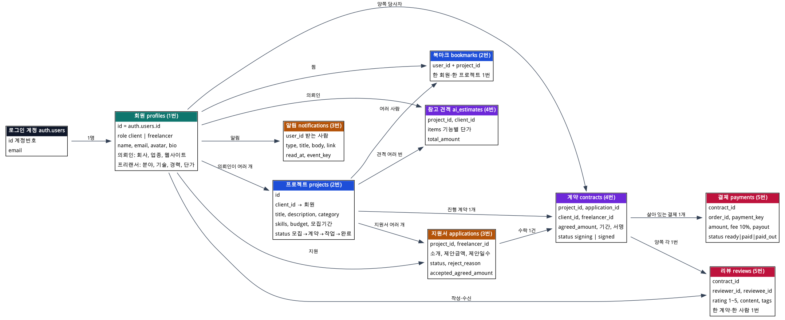

# WorkBridge 전체 ERD

작성: 2026-11-26 (한국시간)

이 문서는 위시켓 공개 화면을 다시 보고, 팀이 이미 만든 표를 한 장으로 맞춘 전체 ERD입니다. 그림은 `docs/specs/erd.png` 입니다.

2번이 컬럼 단위로 먼저 그려 둔 그림과 설명은 `feat/2-projects` 의 `docs/specs/2-erd.md`, `docs/specs/2-erd.png` 입니다. 칸 이름과 제약의 자세한 대조는 그 문서를 기준으로 하고, 여기서는 공개 화면에서 확인한 흐름과 우리 표가 어디까지 담는지 적습니다.

## 1. 위시켓 공개 화면을 다시 본 방법

2026-11-26에 로그인하지 않고 아래만 열었습니다.

- 메인 `https://www.wishket.com/`
- 프로젝트 찾기 `https://www.wishket.com/project/`

로그인해야 열리는 등록, 지원, 계약, 결제 화면은 열지 않았습니다. 문구와 디자인은 가져오지 않고, 화면에 어떤 정보가 있는지만 보았습니다.

공개 화면에서 확인한 정보의 흐름은 이렇습니다.

1. 방문자 메뉴는 프로젝트 등록, 프로젝트 찾기, 파트너 찾기, 이용방법, 포트폴리오입니다.
2. 메인에는 프로젝트 목록 검색창이 없고, 만들고 싶은 것을 문장으로 넣는 유사 사례 입력이 있습니다.
3. 프로젝트 찾기는 외주(도급)와 기간제(상주)로 나뉩니다. 검색 대상은 전체, 제목, 관련 기술, 프로젝트 내용입니다.
4. 외주 필터에는 업무 범위(개발·디자인·기획), 카테고리, 프로젝트 분야, 예상 금액, 예상 기간, 예상 시작일, 진행 분류, 클라이언트 위치가 있습니다.
5. 기간제 필터에는 역할, 레벨, 경력, 기술 스택, 근무 시작일, 월 금액, 예상 기간, 근무 위치, 산업 분야, 프로젝트 유형, 지원, 인력 상황이 있습니다.
6. 정렬은 금액, 지원 수, 최신 등록, 마감 임박입니다. 모집 마감 글을 빼는 선택이 있습니다.
7. 필터를 이름 붙여 저장하는 기능은 로그인 뒤에만 됩니다.
8. 공개 안내에는 선금을 먼저 주지 않고 결과 확인 뒤에 대금을 주는 보호 순서가 있습니다.

## 2. 우리 표가 담는 것

위 흐름을 우리 SQL 10개 표로 받으면 아래처럼 됩니다. 표 이름과 상태값은 `docs/TEAM.md` 를 그대로 씁니다.

| 위시켓에서 본 정보 | 우리 표 | 담는 칸 |
| --- | --- | --- |
| 회원, 의뢰인·프리랜서 | `profiles` | 역할, 이름, 회사 또는 기술·경력 |
| 외주 프로젝트 | `projects` | 제목, 설명, 분야, 기술, 예산, 모집 기간, 상태 |
| 관심 프로젝트 | `bookmarks` | 회원과 프로젝트 짝, 한 번만 |
| 제안서 | `applications` | 소개, 제안 금액, 제안 일수, 수락 금액 |
| 진행 알림 | `notifications` | 받는 사람, 종류, 제목, 이동 주소, 읽음 |
| 문장으로 만든 참고 금액 | `ai_estimates` | 기능별 단가와 총액. 합의 금액과는 다름 |
| 합의와 서명 | `contracts` | 수락 금액, 시작·종료, 양쪽 서명 |
| 결과 확인 뒤 대금 | `payments` | 계약 금액, 수수료 10%, 정산액, 보관·정산 상태 |
| 끝난 뒤 평가 | `reviews` | 별점, 글, 태그. 한 계약에 한 사람당 한 번 |

## 3. 공개 화면에는 있지만 우리 표에는 없는 것

이번 주 범위 밖이라 표를 만들지 않았습니다.

- 기간제(상주)의 역할, 레벨, 월 금액, 근무 위치. 우리 프로젝트는 외주 한 종류입니다.
- 클라이언트 위치, 모집 마감 글을 숨기는 토글용 별도 컬럼. 모집 상태는 `projects.status` 와 기간으로 계산합니다.
- 필터 저장. 로그인 기능이지만 표를 만들지 않았습니다.
- 담당 매니저, 파트너 등급, 포트폴리오 작품 목록. 프리랜서 포트폴리오는 `profiles.portfolio_url` 한 칸입니다.
- 유사 사례 검색 결과 목록. 우리는 프로젝트 설명으로 참고 견적만 만듭니다.

## 4. 표가 이어지는 순서

1. 가입하면 `profiles` 한 줄이 생깁니다. 번호는 로그인 계정과 같습니다.
2. 의뢰인이 `projects` 를 올립니다.
3. 프리랜서가 `applications` 를 씁니다. 같은 프로젝트에는 한 번입니다.
4. 의뢰인이 한 명을 수락하면 프로젝트는 계약 대기가 되고, 그 지원서의 수락 금액이 계약 금액의 출발점입니다.
5. 프리랜서가 동의하면 `contracts` 가 서명 중이 되고, 양쪽이 서명하면 체결입니다. 거부하면 프로젝트는 다시 모집 중으로 돌아갑니다.
6. 체결된 계약만 `payments` 를 시작합니다. 승인되면 프로젝트는 작업 중, 납품 요청 뒤 완료 승인이면 정산 완료입니다.
7. 완료된 계약에서만 `reviews` 를 씁니다. 의뢰인과 프리랜서가 서로 한 번씩입니다.
8. 각 단계의 알림은 `notifications` 한 표에만 쌓입니다.

평균 별점은 표가 아니라 `review_summaries` 조회용 화면입니다. 리뷰 줄을 모아 계산합니다.

## 5. 상태값

| 표 | 값 |
| --- | --- |
| 프로젝트 | `scheduled` 모집 예정, `recruiting` 모집 중, `closed` 모집 마감, `contract_pending` 계약 대기, `in_progress` 작업 중, `delivered` 납품 요청, `completed` 완료, `cancelled` 취소 |
| 지원서 | `pending` 검토중, `accepted` 수락, `rejected` 거절 |
| 거절 이유 | `manual` 직접, `auto` 다른 사람 수락, `closed` 모집 마감, `negotiation_failed` 금액 거부 |
| 계약 | `negotiating` 금액 합의 중, `signing` 서명 중, `signed` 체결, `cancelled` 취소 |
| 결제 | `ready` 대기, `paid` 보관, `paid_out` 정산 완료, `failed` 실패, `refunded` 환불 |

칸 전체 목록과 “한 번만” 인덱스 이름은 2번 문서 `docs/specs/2-erd.md` 와 같습니다. SQL은 `supabase/migrations/` 의 `0100`부터 `0502`까지입니다.
